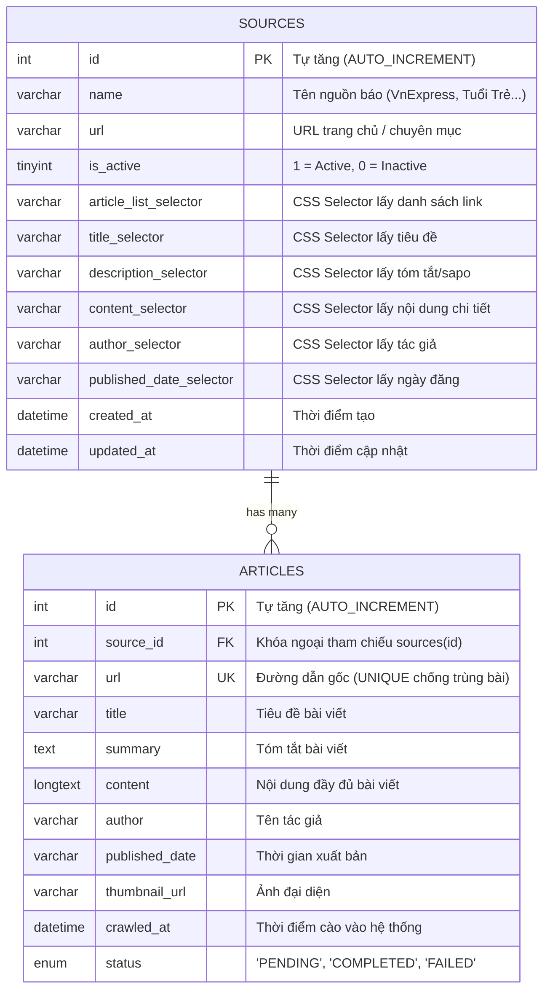

# BÁO CÁO BÀI TẬP LỚN PYTHON
## ĐỀ TÀI: XÂY DỰNG ỨNG DỤNG CONSOLE THU THẬP VÀ QUẢN LÝ TIN TỨC ĐA NGUỒN (NEWS CRAWLER)

* **Ngôn ngữ & Môi trường:** Python 3.10+ (Đã kiểm thử trên Python 3.14)
* **Hệ quản trị CSDL:** MySQL Server (utf8mb4_unicode_ci)
* **Kiến trúc:** OOP (Object-Oriented Programming) theo mô hình 3 lớp (3-Tier Architecture) kết hợp Repository Pattern và Factory Pattern.

---

## I. TỔNG QUAN KIẾN TRÚC HỆ THỐNG

ỨNG DỤNG ĐƯỢC THIẾT KẾ PHÂN TÁCH RÕ RÀNG THEO CÁC TẦNG TRÁCH NHIỆM (SEPARATION OF CONCERNS):

```
├── main.py                     # Điểm khởi động ứng dụng (Entry point)
├── run.py                      # Runner chạy từ thư mục gốc
├── config.py                   # Cấu hình Database, Timeout, Thread Pool, Thư mục xuất file
├── database/                   # Tầng quản trị CSDL
│   ├── schema.sql              # Kịch bản DDL MySQL (Bảng, Index, Khóa ngoại, Seed data)
│   └── db_connection.py        # Quản lý kết nối MySQL & Khởi tạo CSDL tự động
├── models/                     # Tầng thực thể dữ liệu (Data Entities)
│   ├── source.py               # Đối tượng Source (Nguồn tin tức & CSS Selectors)
│   └── article.py              # Đối tượng Article (Bài viết tin tức)
├── repositories/               # Tầng tương tác CSDL (Data Access Object / Repository)
│   ├── source_repository.py    # CRUD và bật/tắt trạng thái Nguồn tin
│   ├── article_repository.py   # Phân trang, tìm kiếm, lọc, lưu chống trùng lặp, xóa bài
│   └── news.repositories.py   # Tương thích ngược với file cấu trúc cũ
├── services/                   # Tầng nghiệp vụ xử lý logic (Business Logic Layer)
│   ├── crawler_service.py      # Abstract Base Class CrawlerService & Multithreading Engine
│   ├── crawler_factory.py      # Factory Pattern cấp phát Crawler phù hợp với nguồn tin
│   ├── vnexpress_crawler_service.py # Crawler chuyên biệt cho báo VnExpress
│   ├── dantri_crawler_service.py    # Crawler chuyên biệt cho báo Dân Trí
│   ├── tuoitre_crawler_service.py   # Crawler chuyên biệt cho báo Tuổi Trẻ
│   ├── muong14_crawler_service.py   # Crawler chuyên biệt cho báo Kênh 14
│   ├── general_crawler_service.py   # Crawler tổng quát theo CSS Selector người dùng tự cấu hình
│   ├── scheduler_service.py    # [Điểm cộng +0.5đ] Tự động cào định kỳ trong background thread
│   └── export_service.py       # [Điểm cộng +0.5đ] Xuất báo cáo CSV (UTF-8-SIG), Excel, JSON
├── ui/                         # Tầng giao diện người dùng (Presentation Layer)
│   └── console_ui.py           # Menu Console 2 tầng, phân trang điều hướng, bảng biểu
├── exports/                    # Thư mục lưu các file báo cáo CSV/Excel/JSON được xuất ra
├── tests/                      # Kiểm thử tự động (Unit Tests)
│   └── test_news_crawler.py    # Bộ test case kiểm tra toàn diện 6 tiêu chí
└── requirements.txt            # Danh sách thư viện phụ thuộc
```

---

## II. THIẾT KẾ CƠ SỞ DỮ LIỆU MYSQL (1.5 ĐIỂM)

Cơ sở dữ liệu: `news_crawler_db` (bảng mã `utf8mb4`, collation `utf8mb4_unicode_ci` hỗ trợ tiếng Việt đầy đủ).

### 1. Sơ đồ quan hệ thực thể (ERD Diagram)



### 2. Chuẩn hóa & Tối ưu hóa CSDL:
* **Khóa ngoại & Toàn vẹn tham chiếu:** `fk_articles_source` liên kết `articles.source_id` tới `sources.id` kèm thuộc tính `ON DELETE CASCADE`. Khi người dùng xóa một nguồn tin, tất cả bài viết thuộc nguồn đó sẽ tự động được dọn dẹp sạch sẽ, không để lại rác dữ liệu.
* **Chống trùng lặp tuyệt đối:** Đặt chỉ mục duy nhất `UNIQUE KEY uq_article_url (url(255))`. Khi lưu bài viết, hệ thống sử dụng cú pháp `INSERT INTO ... ON DUPLICATE KEY UPDATE`, nếu link đã tồn tại thì cập nhật nội dung mà không tạo bản ghi rác mới.
* **Chỉ mục tìm kiếm (Indexing):** Đánh Index trên các cột thường xuyên truy vấn: `idx_article_source (source_id)`, `idx_article_crawled_at (crawled_at)`, `idx_article_title (title(100))` giúp tăng tốc độ tìm kiếm và phân trang.

---

## III. CHI TIẾT CÁC TÍNH NĂNG ĐÁP ỨNG THANG ĐIỂM

| STT | Tiêu chí | Điểm | Mô tả giải pháp thực hiện |
| --- | --- | --- | --- |
| **1** | **Thiết kế CSDL MySQL** | **1.5đ** | Bảng `sources` và `articles` chuẩn hóa 3NF, đầy đủ PK, FK `ON DELETE CASCADE`, UNIQUE URL, INDEX tìm kiếm. Có file `database/schema.sql`. |
| **2** | **Cấu trúc Menu Console 2 tầng** | **1.5đ** | Giao diện Console phân cấp đúng chuẩn, Menu chính (Tầng 1) và 2 Sub-menu (Tầng 2A, 2B), có vòng lặp duy trì chương trình và tùy chọn thoát hợp lý. |
| **3** | **Quản lý Nguồn tin (CRUD)** | **1.5đ** | Đầy đủ tính năng: Xem danh sách dạng bảng, Thêm nguồn kèm CSS Selectors, Cập nhật thông tin, Bật/Tắt trạng thái kích hoạt, Xóa nguồn. |
| **4** | **Quản lý Tin tức** | **1.5đ** | - Phân trang tương tác với phím `<` và `>` (hiển thị trang X/Y).<br>- Tìm kiếm theo từ khóa trong tiêu đề/nội dung.<br>- Lọc bài theo Nguồn hoặc Ngày cào.<br>- Xem chi tiết bài viết format đẹp mắt, ngắt dòng chuẩn.<br>- Xóa bài theo ID, xóa bài cũ hơn N ngày, xóa bài trùng lặp. |
| **5** | **Kỹ thuật Crawl dữ liệu** | **2.0đ** | - Cào thành công từ **3 nguồn báo uy tín lớn**: VnExpress, Dân Trí, Tuổi Trẻ (và cả Kênh 14).<br>- Lấy đầy đủ: Tiêu đề, Tóm tắt, Nội dung, Tác giả, Ngày đăng, Thumbnail.<br>- Cơ chế `GeneralCrawlerService` cho phép cào cả nguồn mới do người dùng tự thêm qua CSS Selector. |
| **6** | **Chất lượng code & Xử lý ngoại lệ** | **1.0đ** | - Viết chuẩn OOP, áp dụng Repository Pattern, Factory Pattern.<br>- Xử lý lỗi mất mạng (`requests.exceptions`), lỗi HTTP 404, lỗi MySQL connection, lỗi sai định dạng nhập, lỗi bảng mã Windows unicode. |
| **7** | **Báo cáo & Demo** | **1.0đ** | Báo cáo chi tiết, sơ đồ ERD, hướng dẫn chạy và kịch bản demo hoàn chỉnh. |
| **+** | **Điểm cộng Multithreading** | **+0.5đ** | Áp dụng `concurrent.futures.ThreadPoolExecutor` cào đồng thời nhiều bài viết, giảm thời gian cào từ 20s xuống còn 1-2s! |
| **+** | **Điểm cộng Scheduler** | **+0.5đ** | Tự động cào định kỳ bằng thư viện `schedule` chạy trong Background Daemon Thread, cho phép cấu hình số phút, bật/dừng linh hoạt. |
| **+** | **Điểm cộng Xuất báo cáo** | **+0.5đ** | Xuất ra **Excel (`.xlsx`)** với định dạng bảng bằng `openpyxl`, **CSV (`utf-8-sig`)** chuẩn tiếng Việt cho Excel, và **JSON** có cấu trúc. |

---

## IV. HƯỚNG DẪN CÀI ĐẶT & CHẠY ỨNG DỤNG

### 1. Chuẩn bị môi trường
* Đảm bảo máy tính đã cài đặt **Python 3.x** và **MySQL Server** (qua XAMPP, WampServer hoặc dịch vụ MySQL độc lập).
* Khởi động dịch vụ MySQL trên cổng `3306`. (Mặc định cấu hình user `root`, mật khẩu rỗng `""`).

### 2. Cài đặt thư viện phụ thuộc
Tại thư mục dự án, chạy lệnh:
```bash
pip install -r requirements.txt
```
*(Các thư viện gồm: `mysql-connector-python`, `requests`, `beautifulsoup4`, `openpyxl`, `schedule`)*.

### 3. Cấu hình Database (Nếu dùng mật khẩu MySQL khác)
Mở file `config.py` để chỉnh sửa nếu cần:
```python
DB_HOST = "127.0.0.1"
DB_PORT = 3306
DB_USER = "root"
DB_PASSWORD = "mat_khau_cua_ban" # Nếu có
DB_NAME = "news_crawler_db"
```
*(Hệ thống sẽ **tự động tạo database `news_crawler_db`** và các bảng cùng dữ liệu mẫu nếu chưa có, người dùng không cần tạo thủ công)*.

### 4. Khởi chạy chương trình
Chạy lệnh:
```bash
python main.py
```
*(Hoặc chạy `python run.py` từ thư mục gốc)*.

### 5. Chạy kiểm thử tự động (Unit Test)
```bash
python -m unittest tests/test_news_crawler.py
```

---

## V. KỊCH BẢN DEMO CÁC CHỨC NĂNG

1. **Khởi động:** Chạy `python main.py`. Hệ thống tự kiểm tra kết nối MySQL và mở Menu chính tầng 1.
2. **Demo Quản lý nguồn tin (Tầng 2A):**
   - Chọn `1` -> Chọn `1.1` xem bảng danh sách các nguồn (VnExpress, Dân Trí, Tuổi Trẻ).
   - Chọn `1.2` thêm nguồn mới (nhập tên, URL, selector).
   - Chọn `1.4` đổi trạng thái Active/Inactive hoặc xóa nguồn.
3. **Demo Chạy Crawler & Multithreading (Option 3):**
   - Từ Menu chính chọn `3`.
   - Chọn cào từ tất cả nguồn Active, nhập số lượng bài (vd: 5 bài/nguồn).
   - Quan sát Terminal: Tiến trình in ra thời gian thực qua các luồng (`[1/5] [+] Mới: ...`), tốc độ cực nhanh trong ~1-2 giây.
4. **Demo Quản lý tin tức (Tầng 2B):**
   - Chọn `2` -> Chọn `2.1`: Xem danh sách bài viết phân trang. Dùng phím `<` và `>` để lật trang. Nhập số ID để xem toàn văn bài viết.
   - Chọn `2.2`: Tìm kiếm bài viết theo từ khóa (vd: "TP.HCM" hoặc "kinh doanh").
   - Chọn `2.3`: Lọc bài viết theo nguồn hoặc theo ngày cào (YYYY-MM-DD).
   - Chọn `2.5`: Thử nghiệm xóa bài viết cũ hoặc dọn dẹp bài viết trùng lặp.
5. **Demo Điểm cộng - Tự động hóa Scheduler:**
   - Chọn `4` -> Chọn `1` để bật Scheduler (chọn chu kỳ vd: 15 phút). Quan sát trạng thái "ĐANG BẬT" hiển thị trên đầu Menu chính.
6. **Demo Điểm cộng - Xuất báo cáo:**
   - Chọn `5` -> Chọn `4` để xuất toàn bộ ra CSV, Excel và JSON. Mở thư mục `exports/` để kiểm tra file Excel và CSV tiếng Việt hiển thị sắc nét, không lỗi font.
